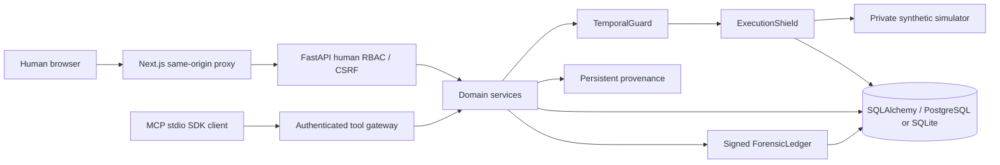

# Architecture

The blueprint's security invariants are implemented in a modular monolith with an independent Python domain core. Next.js App Router / React / TypeScript supplies the UI; FastAPI and Pydantic supply versioned APIs; SQLAlchemy and Alembic supply persistence. PostgreSQL 16 is provided by Compose. Native Windows mode uses SQLite WAL as an explicitly documented fallback.

## Entities and storage

Organizations, users, mandates, approvals, budget reservations and audit events have dedicated tables. The `records` table stores typed JSON documents for agents, workflows, sessions, supplier profiles, source documents, field provenance, POs, transactions, decisions, receipts, alerts, auth sessions, and experiments. It has foreign keys to organizations and parent records plus kind/parent/time indexes. Session parentage, source IDs and field ancestry are application-validated within the tenant. This compact document-table approach departs from a dedicated table for every blueprint entity; JSON foreign references do not have database FK enforcement.

Money uses integer minor units. Every signed payment includes schema, organization, mandate/version, actor, tool, supplier, beneficiary reference, amount, currency, invoice, PO, workflow, session, provenance, idempotency key, transaction expiry and unpredictable nonce.

## Canonical encoding

`app/crypto.py` uses UTF-8 JSON, NFC-normalized strings and keys, lexicographically sorted keys, no whitespace, explicit null preservation, and integers only. Floating-point authorization fields are forbidden. Durations measured as floating-point milliseconds are converted to fixed decimal strings before inclusion in signed audit content. This encoding is versioned locally and is not claimed as full RFC 8785/JCS interoperability.

## Authority and execution

The backend alone loads a newly generated Ed25519 private key from its data directory. Agents get opaque bearer tokens; they never get signing keys or simulator credentials. Administrative mandates and human approvals require separate human roles. Mandate creation must stay within registered agent capabilities, and child capabilities cannot exceed those of their parents.

Execution always recomputes the transaction digest, verifies current mandate and policy state, resolves the complete beneficiary provenance ancestry and matches actual invoice/PO constraints. An optional human approval signature covers digest, nonce, expiry, transaction and approver. Hard denials cannot be overridden.

An atomic conditional UPDATE reserves mandate budget, a unique reservation constrains transaction/idempotency/invoice, and approval status is consumed atomically in the same database transaction. PostgreSQL organization-row locks serialize audit appends and sensitive execution; SQLite uses BEGIN IMMEDIATE for native HTTP mutations. Unique constraints and conditional updates provide a final concurrency boundary. The deterministic simulator has no external side effects and is called inside that transaction. Real payment adapters would require a durable outbox, reconciliation and recovery design.

Repeated exact requests return their prior receipt, including timed-out and unknown outcomes. They do not invoke the simulator again. Known simulator failures release budget; uncertain outcomes retain it. Invoice and idempotency reservations remain to prevent accidental duplicate retries.

## Provenance

Invoice intake records a source hash and external trust label for each critical field. Copies into persistent storage and retrieval in Session B create new provenance rows with parent IDs; labels are preserved. A separately recorded registry lookup creates a verified beneficiary reference. The policy checks that the selected beneficiary matches the approved registry and that its ancestry remains verified. External invoice fields supply amount, currency, supplier and invoice constraints. A hash attests to recorded bytes, not their truth.

## Audit and experiments

Audit events include actor, organization, workflow/session, timestamp, parent event, policy version, previous hash and content hash, with an Ed25519 signature for every hash. Triggers reject UPDATE/DELETE. Verification recomputes hashes, links and signatures and returns a signed head checkpoint. External anchoring and protection against privileged whole-stream deletion are not implemented.

RedTeamLab creates a new synthetic organization per environment. Baseline/basic adapters are deliberately vulnerable and accessible only inside the human-authorized lab runner. They cannot execute normal-tenant transactions. Results and exact trial configuration are persisted in the source tenant. The procurement agent is a deterministic structured-data state machine, not an LLM or LangGraph integration. It uses the same monitored gateway functions as the MCP transport.
